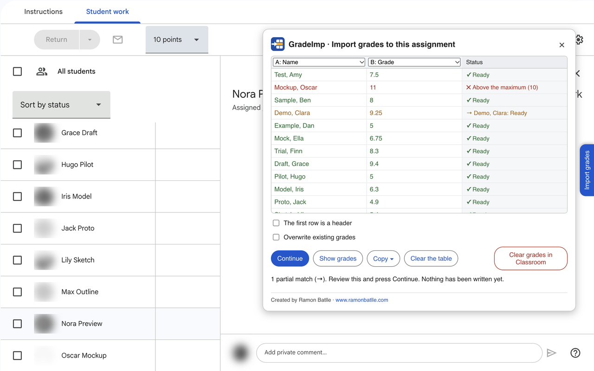

# GradeImp

[Català](README.md) · [Castellano](README.es.md) · **English**

Chrome extension to copy grades from Excel or Sheets into an assignment that already exists in Google Classroom, without creating a new one.



*Example of the extension in use.*

## ✨ How it works

Open a Classroom assignment and go to **Student work**. On the right side of the page there is an **Import grades** tab. Paste the grades from your spreadsheet, check which columns are the name and the grade, and press **Import**. The assignment must have points.

New grades are saved as drafts, so you can review them before returning them from Classroom.

Also:

- Names can be in a different order and a surname can be missing. If there is any doubt, it is shown before anything is written.
- Existing grades are only changed if the overwrite box is checked. If a grade has already been returned, the extension warns you first.
- **Show grades** lets you see the assignment's grades and copy them to a spreadsheet. If you sort the Classroom list by last name, grades are copied in that order.
- **Clear grades in Classroom** clears all the assignment's grades, after asking for confirmation.
- It is available in Catalan, Spanish and English, following Classroom's language.

## 🚀 Installation for testing

1. Download this folder.
2. Open `chrome://extensions` and turn on **Developer mode**.
3. Press **Load unpacked** and choose the folder.

## 🔒 Privacy

Names and grades are only used in the browser. The extension does not send them to any server. More information in the [privacy policy](https://ramonbatlle.com/index.php/en/gradeimp-privacy/).

## ⚠️ Limitations

GradeImp writes directly on the Classroom page, without using the Google API. If Google changes the page, it may stop working. It only works in Chrome, or Chrome-based browsers, and on the Classroom website, not in the mobile app. It is best to try it first on a test assignment and always review the grades.

## Code

The code is in `src/`:

- `classroom.js`: reads and writes on the page.
- `noms.js`: compares names.
- `taula.js` and `pla.js`: read the table and decide what to do with each row.
- `panell.js` and `graella.js`: user interface.
- `inici.js`: creates the panel when «Student work» is opened.
- `textos.js`: texts in Catalan, Spanish and English.
- `dom.js`: tools to build the panel.

To run the tests you need [Node.js](https://nodejs.org):

```
node --test tests/*.test.js
```

## Author

Ramon Batlle · [www.ramonbatlle.com](https://www.ramonbatlle.com)
