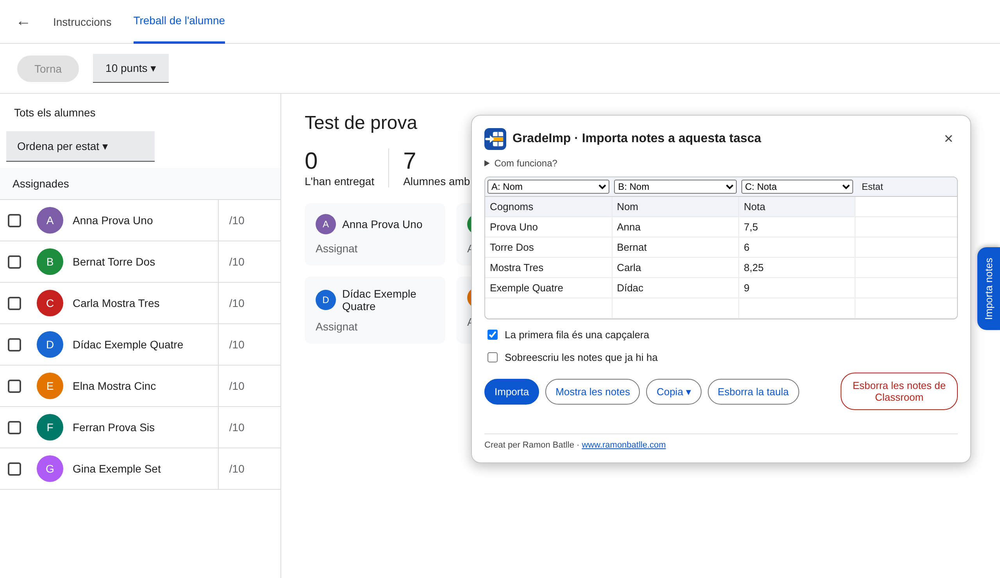

# GradeImp

[Català](README.md) · **Castellano**

Extensión de Chrome para pasar notas de Excel o Sheets a una tarea que ya existe en Google Classroom, sin crear una nueva.




*Ejemplo de la extensión en funcionamiento.*

## ✨ Funcionamiento

Abre una tarea de Classroom y ve a **Trabajo de los alumnos**. A la derecha de la página está la pestaña **Importar notas**. Pega las notas desde la hoja de cálculo, comprueba qué columnas corresponden al nombre y a la nota, y pulsa **Importar**.

Las notas nuevas quedan como borrador, de modo que se pueden revisar antes de devolverlas desde Classroom.

Además:

- Los nombres pueden estar en otro orden y puede faltar un apellido. Si hay dudas, se muestran antes de escribir nada.
- Las notas que ya existen solo se cambian si se marca la casilla de sobrescribir. Si una nota ya está devuelta, la extensión avisa antes.
- **Mostrar las notas** permite ver las notas de la tarea y copiarlas a una hoja de cálculo.
- Está disponible en catalán, castellano e inglés, según el idioma de Classroom.

## 🚀 Instalación para pruebas

1. Descarga esta carpeta.
2. Abre `chrome://extensions` y activa el **Modo de desarrollador**.
3. Pulsa **Cargar descomprimida** y elige la carpeta.

## 🔒 Privacidad

Los nombres y las notas se usan solo en el navegador. La extensión no los envía a ningún servidor.

## ⚠️ Limitaciones

GradeImp escribe directamente en la página de Classroom, sin usar la API de Google. Si Google cambia la página, puede dejar de funcionar. Se recomienda probarla primero en una tarea de prueba y revisar siempre las notas.

## Código

El código está en `src/`:

- `classroom.js`: lee y escribe en la página.
- `noms.js`: compara los nombres.
- `taula.js` y `pla.js`: interpretan la tabla y deciden qué se hace con cada fila.
- `panell.js` y `graella.js`: interfaz.

Para pasar las pruebas:

```
node --test tests/*.test.js
```

## Autor

Ramon Batlle · [www.ramonbatlle.com](https://www.ramonbatlle.com)
