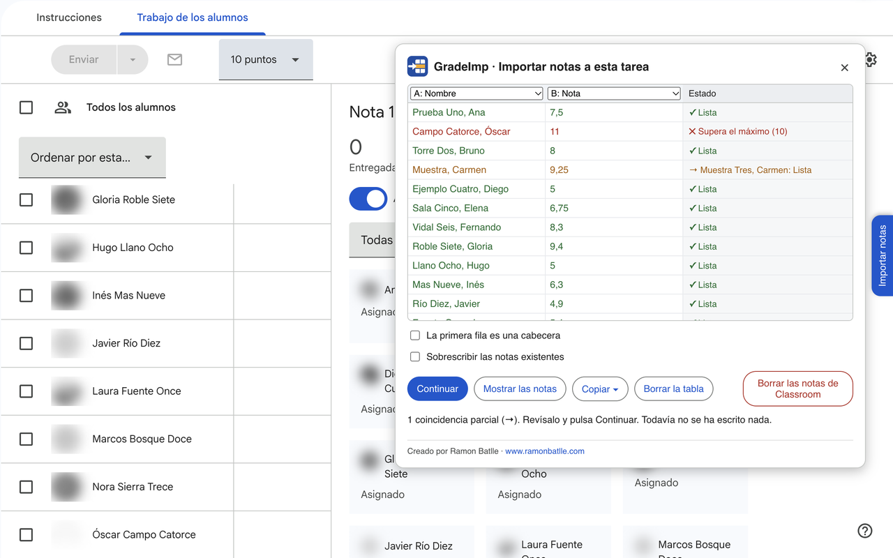

# GradeImp

[Català](README.md) · **Castellano** · [English](README.en.md)

Extensión de Chrome para pasar notas de Excel o Sheets a una tarea que ya existe en Google Classroom, sin crear una nueva.

**[Instala GradeImp desde Chrome Web Store](https://chromewebstore.google.com/detail/gradeimp/bjdjohcckaoicplhkcmlamggpjajajbp)**



*Ejemplo de la extensión en funcionamiento.*

## ✨ Funcionamiento

Abre una tarea de Classroom y ve a **Trabajo de los alumnos**. A la derecha de la página está la pestaña **Importar notas**. Pega las notas desde la hoja de cálculo, comprueba qué columnas corresponden al nombre y a la nota, y pulsa **Importar**. La tarea debe tener puntuación.

Las notas nuevas quedan como borrador, de modo que se pueden revisar antes de devolverlas desde Classroom.

Además:

- Los nombres pueden estar en otro orden y puede faltar un apellido. Si hay dudas, se muestran antes de escribir nada.
- Las notas que ya existen solo se cambian si se marca la casilla de sobrescribir. Si una nota ya está devuelta, la extensión avisa antes.
- **Mostrar las notas** permite ver las notas de la tarea y copiarlas a una hoja de cálculo. Si ordenas la lista de Classroom por apellido, las notas se copian en ese orden.
- **Borrar las notas de Classroom** borra todas las notas de la tarea, tras pedir confirmación.
- Está disponible en catalán, castellano e inglés, según el idioma de Classroom.

## 🚀 Instalación

Instálala desde [Chrome Web Store](https://chromewebstore.google.com/detail/gradeimp/bjdjohcckaoicplhkcmlamggpjajajbp). Así se actualiza sola.

Para probar el código:

1. Descarga este repositorio con **Code > Download ZIP** y descomprímelo.
2. Abre `chrome://extensions` y activa el **Modo de desarrollador**.
3. Pulsa **Cargar descomprimida** y elige la carpeta.

Si también tienes instalada la versión de la tienda, desactívala mientras haces pruebas.

## 🔒 Privacidad

Los nombres y las notas se usan solo en el navegador. La extensión no los envía a ningún servidor. Más información en la [política de privacidad](https://ramonbatlle.com/index.php/es/gradeimp-privacidad/).

## ⚠️ Limitaciones

GradeImp escribe directamente en la página de Classroom, sin usar la API de Google. Si Google cambia la página, puede dejar de funcionar. Solo funciona en Chrome, o en navegadores basados en Chrome, y en la versión web de Classroom, no en la app del móvil. Se recomienda probarla primero en una tarea de prueba y revisar siempre las notas.

## Código

El código está en `src/`:

- `classroom.js`: lee y escribe en la página.
- `noms.js`: compara los nombres.
- `taula.js` y `pla.js`: interpretan la tabla y deciden qué se hace con cada fila.
- `panell.js` y `graella.js`: interfaz.
- `inici.js`: crea el panel al abrir «Trabajo de los alumnos».
- `textos.js`: textos en catalán, castellano e inglés.
- `dom.js`: herramientas para construir el panel.

Para pasar las pruebas hace falta [Node.js](https://nodejs.org):

```
node --test tests/*.test.js
```

## Licencia

[CC BY-NC-SA 4.0](https://creativecommons.org/licenses/by-nc-sa/4.0/): se puede usar y adaptar citando al autor, sin fines comerciales y compartiendo los cambios con la misma licencia. Ver [LICENSE](LICENSE).

## Autor

Ramon Batlle · [www.ramonbatlle.com](https://www.ramonbatlle.com)
