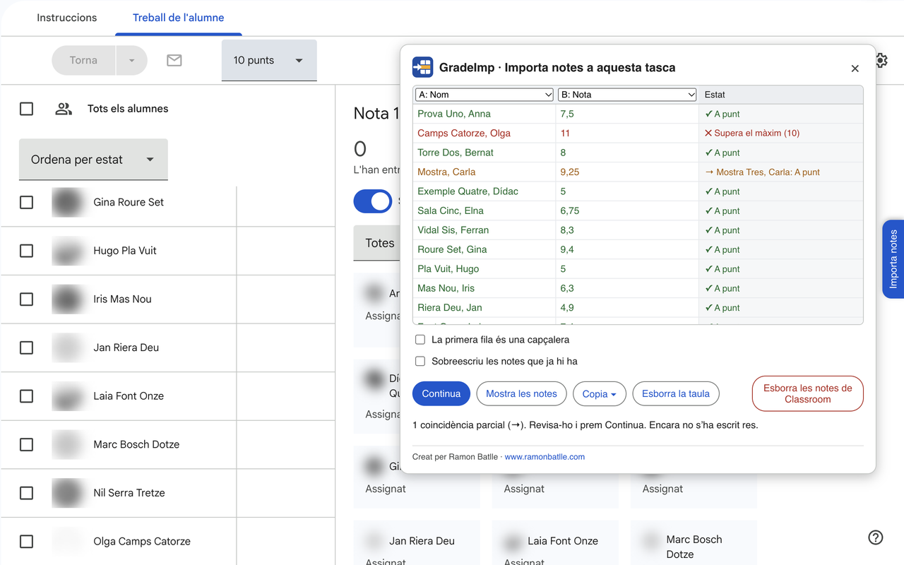

# GradeImp

**Català** · [Castellano](README.es.md) · [English](README.en.md)

Extensió de Chrome per passar notes d'Excel o Sheets a una tasca que ja existeix a Google Classroom, sense crear-ne una de nova.

**[Instal·la GradeImp des de la Chrome Web Store](https://chromewebstore.google.com/detail/gradeimp/bjdjohcckaoicplhkcmlamggpjajajbp)**



*Exemple de l'extensió en funcionament.*

## ✨ Funcionament

Obre una tasca de Classroom i ves a **Treball de l'alumne**. A la dreta de la pàgina hi ha la pestanya **Importa notes**. Enganxa-hi les notes des del full de càlcul, comprova quines columnes corresponen al nom i a la nota, i prem **Importa**. La tasca ha de tenir puntuació.

Les notes noves queden com a esborrany, de manera que es poden revisar abans de tornar-les des de Classroom.

A més:

- Els noms poden estar en un altre ordre i pot faltar-hi un cognom. Si hi ha dubtes, es mostren abans d'escriure res.
- Les notes que ja existeixen només es canvien si es marca la casella de sobreescriure. Si una nota ja està retornada, l'extensió avisa abans.
- **Mostra les notes** permet veure les notes de la tasca i copiar-les a un full de càlcul. Si ordenes la llista de Classroom per cognom, les notes es copien en aquest ordre.
- **Esborra les notes de Classroom** esborra totes les notes de la tasca, després de demanar confirmació.
- Està disponible en català, castellà i anglès, segons l'idioma de Classroom.

## 🚀 Instal·lació

Instal·la-la des de la [Chrome Web Store](https://chromewebstore.google.com/detail/gradeimp/bjdjohcckaoicplhkcmlamggpjajajbp). Així s'actualitza sola.

Per provar-ne el codi:

1. Descarrega aquest repositori amb **Code > Download ZIP** i descomprimeix-lo.
2. Obre `chrome://extensions` i activa el **Mode de desenvolupador**.
3. Prem **Carrega una extensió desempaquetada** i tria la carpeta.

Si també tens instal·lada la versió de la botiga, desactiva-la mentre fas proves.

## 🔒 Privacitat

Els noms i les notes es fan servir només al navegador. L'extensió no els envia a cap servidor. Més informació a la [política de privacitat](https://ramonbatlle.com/index.php/gradeimp-privadesa/).

## ⚠️ Limitacions

GradeImp escriu directament a la pàgina de Classroom, sense fer servir l'API de Google. Si Google canvia la pàgina, pot deixar de funcionar. Només funciona a Chrome, o en navegadors basats en Chrome, i a la versió web de Classroom, no a l'app del mòbil. Es recomana provar-la primer en una tasca de prova i revisar sempre les notes.

## Codi

El codi és a `src/`:

- `classroom.js`: llegeix i escriu a la pàgina.
- `noms.js`: compara els noms.
- `taula.js` i `pla.js`: interpreten la taula i decideixen què es fa amb cada fila.
- `panell.js` i `graella.js`: interfície.
- `inici.js`: crea el panell quan s'obre «Treball de l'alumne».
- `textos.js`: textos en català, castellà i anglès.
- `dom.js`: eines per construir el panell.

Per passar les proves cal tenir [Node.js](https://nodejs.org):

```
node --test tests/*.test.js
```

## Autor

Ramon Batlle · [www.ramonbatlle.com](https://www.ramonbatlle.com)
